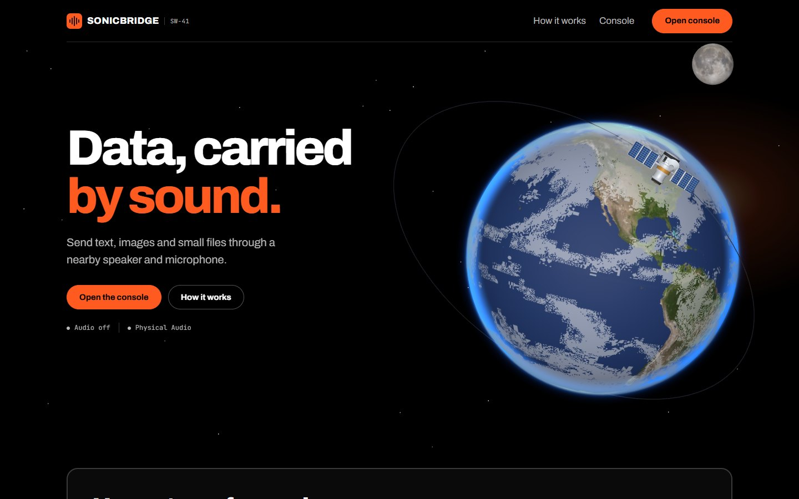
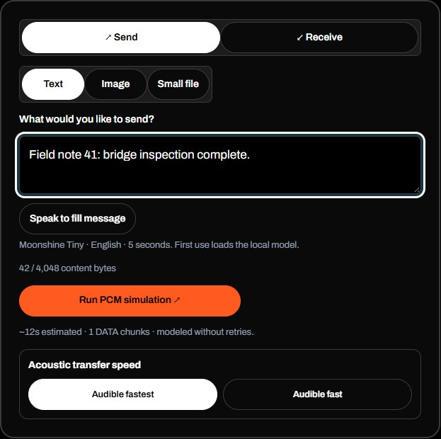
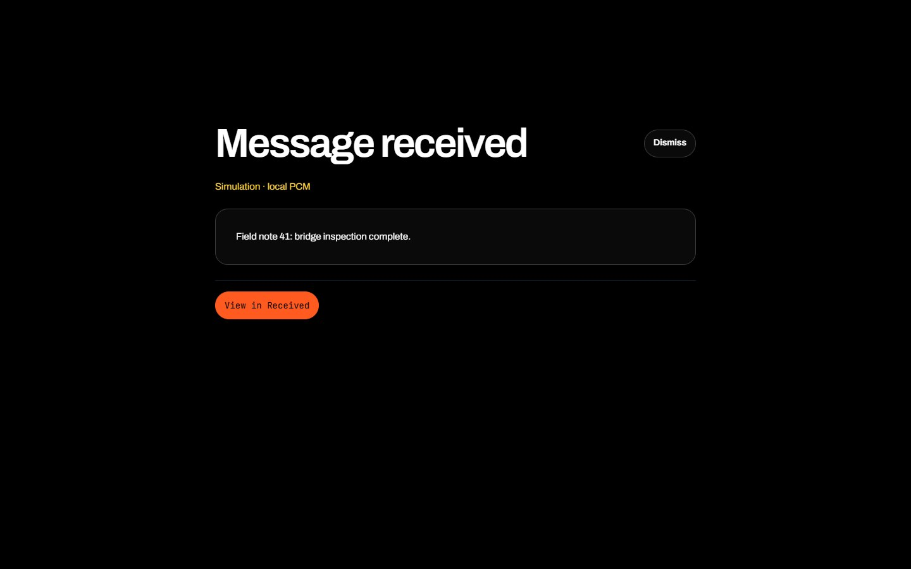

# SONICBRIDGE

Send a short message, thumbnail or small file between nearby devices using their speakers and microphones. Once the app is loaded, the payload and every reply travel through sound. Both devices need a working speaker and microphone because the receiver answers the sender.

[Open SONICBRIDGE](https://sonicbridge-acoustic-link.vercel.app) · [Demo guide](DEMO.md) · [Benchmark results](BENCHMARKS.md)

## Send your first message between two devices

| Step | Sender | Receiver |
| --- | --- | --- |
| 1. Prepare | Open the console, select **Acoustic Transceiver** and **Physical Audio**, then click **Start Audio**. | Do the same. Keep the page visible and allow microphone access when prompted. |
| 2. Listen | Select **Send → Text** and type a short, recognizable message. | Select **Receive → Listen with microphone**. Leave the listener running. |
| 3. Transmit | Click **Start transmission** and allow microphone access so the sender can hear replies. Follow acknowledged bytes and retries in **Transfer monitor**. | Keep the speaker audible so acknowledgements can reach the sender. |
| 4. Confirm | Wait for the final acknowledgement before considering the transfer complete. | Read the **Message received** popup. Choose **View in Received** to return to the verified item. |

For a first attempt, place the devices nearby in a quiet room and use their built-in speakers. If bytes stop advancing, check microphone permissions and speaker output on **both** devices. A working forward path can still have a weak return path.

## Try the workflow on one laptop

1. Click **Start Audio**, select **Simulation · local PCM**, and choose **Send → Text**.
2. Type a message and click **Run PCM simulation**. The app runs the encoder, decoder and reply exchange locally.
3. Compare the popup text with your draft and open **View in Received**. The result carries the simulation label. Physical testing requires a separate two-device run.

| Compose the message | Check the received result |
| --- | --- |
|  |  |

These two console screenshots come from the same local PCM transfer.

## What happens during a transfer

~~~mermaid
sequenceDiagram
    participant S as Sender
    participant R as Receiver
    S->>R: HELLO over sound
    R-->>S: Capabilities
    loop Each numbered chunk
        S->>R: DATA
        R-->>S: ACK for that chunk
    end
    S->>R: FIN
    R->>R: Reassemble and verify content
    R-->>S: FIN_ACK
~~~

React and TypeScript provide the console. Web Audio and an AudioWorklet capture microphone samples, and the locally bundled ggwave WASM modem converts bytes to tones and back. CRC32 checks each packet. The sender retries missing replies within a bounded budget, and the receiver counts duplicate chunks once. SHA-256 verifies reconstructed file contents. Sender completion requires the matching final reply. [Wire format and recovery](PROTOCOL.md)

## Payloads and limits

- **Text** supports UTF-8. For optional English dictation, start audio and choose **Speak to fill message**. Moonshine Tiny adds a transcript to the editable draft. Review it before sending.
- **Images** can be resized locally. The thumbnail preset targets 1–3 KiB on a best-effort basis. Check the actual encoded size and estimated time before sending.
- **Small files** travel as binary chunks. The transfer budget is 4,096 bytes including the manifest and filename, with up to 120 payload bytes per DATA packet.

## Run locally and prepare for offline use

Use Node.js 24 and npm. From the repository root, run:

~~~sh
npm ci
npm run dev
~~~

Open the localhost URL printed by Vite. On a second laptop or phone, open the hosted HTTPS app or use the [local HTTPS setup](HTTPS.md). An ordinary HTTP LAN address can prevent microphone access.

For offline use, open the **production** app online on each device and allow its service worker to finish caching. Reload offline before the demo. Optional dictation needs an additional first-use download of about 45 MiB, so run it once online if you plan to use it offline.

## Verification and further reading

| Command | What it exercises |
| --- | --- |
| `npm test` | Unit and integration tests |
| `npm run build` | Type checking, production bundle and offline assets |
| `npm run test:browser` | Chromium console and audio workflows |
| `npm run test:pwa` | Offline production reload |
| `npm run benchmark` | Repeatable transfers through simulated PCM channels |

The recorded 480-byte benchmark completed **12/12 quiet trials**, **0/12 noise-burst trials** and **0/12 weak-return trials**. These are simulated audio results. Physical range and device compatibility require separate measurements. [Benchmark conditions](BENCHMARKS.md) · [Device matrix](DEVICE_TEST_MATRIX.md) · [Physical test sheet](PHYSICAL_TEST_SHEET.md)
